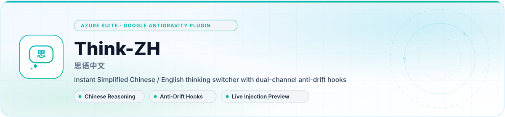
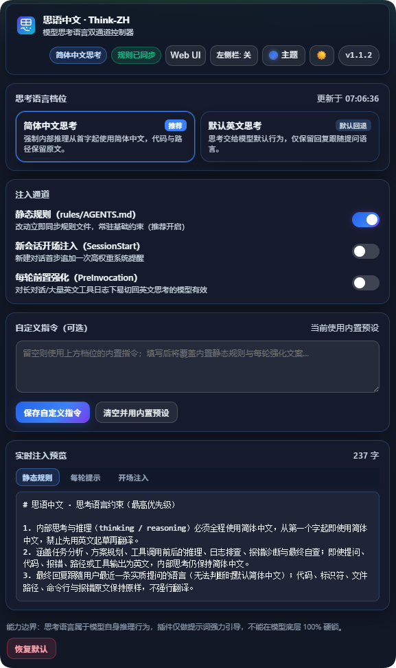
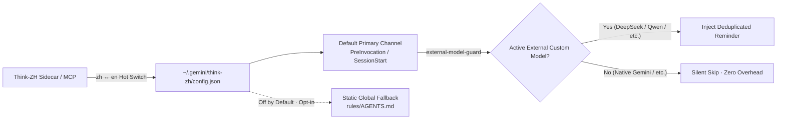

<div align="center">

<p>🌐 &nbsp; <a href="README.md">简体中文</a> &nbsp;·&nbsp; <strong>English</strong></p>

<picture>
  <source media="(prefers-color-scheme: dark)" srcset="assets/readme/hero-en-dark.svg">
  
</picture>

<p>
  <a href="https://github.com/A16Nights/antigravity-think-zh/releases"></a>
  <a href="https://github.com/A16Nights/antigravity-think-zh/stargazers"></a>
  
  
  
  <a href="./LICENSE"></a>
</p>

<p>
  <strong>Built for external custom reasoning models: keep internal reasoning in Simplified Chinese from char #1 while automatically skipping native Antigravity / Gemini models</strong>
</p>

<p>
  <a href="#preview">🖼️ Preview</a> &nbsp;·&nbsp; <a href="#features">✨ Features</a> &nbsp;·&nbsp; <a href="#architecture">🧩 Architecture</a> &nbsp;·&nbsp; <a href="#installation">🚀 Quick Start</a> &nbsp;·&nbsp; <a href="#mcp-tools">🧰 MCP Tools</a> &nbsp;·&nbsp; <a href="#storage">📂 Storage</a> &nbsp;·&nbsp; <a href="#azure-suite">🌌 Azure Suite</a>
</p>

</div>

> [!IMPORTANT]
> **Scope & Why Native Gemini Is Not Affected**
> - **Built for External Custom Models**: Think-ZH targets external reasoning models mounted into Antigravity (e.g., via **[Azure Orbit](https://github.com/A16Nights/antigravity-azure-orbit)** such as DeepSeek, Qwen, GLM, or MiniMax that stream native `reasoning_content`). When enabled, it **only activates on external custom models** and silently skips native Antigravity models with zero extra token overhead.
> - **Why It Cannot Work on Native Gemini**: Google Cloud Code does not send Gemini's raw internal thoughts to the client. Instead, Google's server-side **Thought Summarizer** rewrites internal reasoning into an English third-person summary (alongside an encrypted `thoughtSignature` that cannot be decrypted locally). Client-side prompts or hooks cannot disable or change the summarizer's output language.
> - **How to Read Native Gemini Thoughts in Chinese**: Use **[Azure Prism](https://github.com/A16Nights/antigravity-azure-prism)** to translate the returned thought summaries on demand.

A zero-dependency thinking-language controller for **external custom reasoning models** in **Google Antigravity**. Uses **`external-model-guard` + lifecycle hooks (`PreInvocation` enabled by default with per-turn deduplication + optional `SessionStart`) + optional static fallback + MCP Server + Sidecar UI** to keep external model `thinking / reasoning` in Simplified Chinese without mistranslating code, paths, or error logs, and lets you hot-switch back to default English anytime.

<table>
<tr>
<td width="50%" valign="top">
<h4>💭 Chinese Reasoning for External Models</h4>
Designed for external models streaming native <code>reasoning_content</code>; covers planning, tool reasoning, and debugging while keeping code and raw errors verbatim.
</td>
<td width="50%" valign="top">
<h4>🛡️ External-Model-Only Guard</h4>
Built-in <code>external-model-guard</code> detects <code>custom_models.json</code> and external model IDs; native Gemini / Antigravity models are skipped silently with zero overhead.
</td>
</tr>
<tr>
<td width="50%" valign="top">
<h4>👁️ Custom Directives & Live Preview</h4>
Override built-in directives with <code>customText</code> (clear to restore defaults) and preview exact Hook and optional static fallback payloads live in the panel.
</td>
<td width="50%" valign="top">
<h4>⚡ Hot-Switch Aware & Deduplicated</h4>
Choose <code>per_user_turn</code> or <code>every_invocation</code> granularity; mid-session <code>zh ↔ en</code> switches notify the external model automatically on the next turn.
</td>
</tr>
</table>

<h2 id="preview">
<picture>
  <source media="(prefers-color-scheme: dark)" srcset="assets/readme/sec-preview-en-dark.svg">
  
</picture>
</h2>

<p align="center">
  <a href="assets/readme/preview-panel.png"></a>
  <br><strong>Think-ZH · Thinking Language Switcher, Channel Controls &amp; Live Preview</strong>
  <br><sub>Instant Chinese/English thinking toggle, granular static/hook channel switches, custom directives &amp; live injection preview</sub>
</p>

<h2 id="features">
<picture>
  <source media="(prefers-color-scheme: dark)" srcset="assets/readme/sec-features-en-dark.svg">
  
</picture>
</h2>

### 1. Dual Thinking-Language Presets (Instant Hot-Switch)
- **Simplified Chinese Thinking (Default, `zh`)**:
  - Directs internal reasoning (task analysis, planning, pre/post tool reasoning, log triage, and final checks) to stay in Simplified Chinese from the very first token;
  - Keeps Chinese reasoning even when prompts, code, stack traces, or tool outputs are in English;
  - Preserves code, identifiers, file paths, commands, and raw errors verbatim; final responses match the user's latest prompt language.
- **Default English Thinking (`en`)**:
  - Restores the model's native English reasoning habit while keeping final responses aligned with the user's language.

### 2. External-Model-Only Guard (Zero Interference on Native Models)
- **Per-Turn Pre-Injection (`PreInvocation` + `external-model-guard`, enabled by default)**:
  - Inspects `~/.gemini/antigravity/custom_models.json` and external model path patterns, activating **only when an external custom model is active**;
  - Silently returns `{}` for native Antigravity / Gemini models with zero extra tokens;
  - **Smart Deduplication & Hot-Switch Awareness**: Defaults to `per_user_turn` (once per user turn, skipping repeated tool callbacks), optionally `every_invocation`, and detects mid-conversation `zh ↔ en` switches automatically.
- **Session Start Hook (`SessionStart` + `external-model-guard`, optional)**: Also guarded to activate only when an external custom model is detected.
- **Static Global Fallback (`rules/AGENTS.md`, disabled by default)**: Because Antigravity loads static rules into every session including native Gemini, this channel defaults to off and is kept purely as an opt-in fallback.

### 3. Custom Directives & Live Injection Preview
- Write custom thinking-language instructions (`customText`) right inside the panel (leave blank to restore defaults) and inspect the exact live output for both `AGENTS.md` and Hooks.

### 4. Unified Azure Suite UI
- **Sidecar + Standalone Web UI**: Clean right-hand control panel plus one-click fullscreen `Web UI` in your browser.
- **Neko Glass UI & Shared Theme Center**: Dark/light themes, custom glass dropdowns (`AzureSelect`), 6 official presets + custom dual pickers + 4 shared slots, sidebar toggle, and GitHub Release update checks.

<h2 id="architecture">
<picture>
  <source media="(prefers-color-scheme: dark)" srcset="assets/readme/sec-arch-en-dark.svg">
  
</picture>
</h2>



<h2 id="installation">
<picture>
  <source media="(prefers-color-scheme: dark)" srcset="assets/readme/sec-install-en-dark.svg">
  
</picture>
</h2>

> **Prerequisite**: **Node.js >= 22.0.0** (zero third-party npm dependencies, pure native ESM).

### Option 1 · Let Antigravity Install It for You (Recommended)

Copy and send the following prompt directly to Antigravity:

> Please clone `https://github.com/A16Nights/antigravity-think-zh.git` into my Antigravity global plugins directory as `think-zh`, verify the directory structure, and tell me once it is ready so I can press `Ctrl+R` to reload.

### Option 2 · Manual Git Clone

```powershell
# Windows (PowerShell)
git clone https://github.com/A16Nights/antigravity-think-zh.git "$env:USERPROFILE\.gemini\config\plugins\think-zh"

# macOS / Linux
git clone https://github.com/A16Nights/antigravity-think-zh.git ~/.gemini/config/plugins/think-zh
```

Restart or reload Antigravity (`Ctrl+R`) and verify **Think-ZH** is enabled in **Plugins**.

<h2 id="mcp-tools">
<picture>
  <source media="(prefers-color-scheme: dark)" srcset="assets/readme/sec-tools-en-dark.svg">
  
</picture>
</h2>

| Tool | Description |
| --- | --- |
| `think_zh_status` | Inspect active preset (`zh`/`en`), channel toggles, dedupe granularity, rule sync status, and live preview |
| `think_zh_set` | Update preset, static rule toggle, `SessionStart`/`PreInvocation` toggles, granularity, or `customText` |
| `think_zh_preview` | Dry-run preview of generated static rules and Hook text without writing to disk |
| `think_zh_reset` | Reset all settings to defaults and atomically re-sync `rules/AGENTS.md` |

### 🧪 Local Self-Test

```bash
node --test tests/think-zh.test.mjs
```

<h2 id="storage">
<picture>
  <source media="(prefers-color-scheme: dark)" srcset="assets/readme/sec-storage-en-dark.svg">
  
</picture>
</h2>

<details open>
<summary><strong>Click to inspect local data paths & shared Azure Suite configs</strong></summary>

<br>

- **Thinking Language Config & Session Dedupe State**: `~/.gemini/think-zh/config.json`, `state.json`
- **Shared Azure Suite Theme & Sidebar Config**: `~/.gemini/azure-theme.json`, `~/.gemini/azure-sidebar-nav.json`

</details>

<h2 id="azure-suite">
<picture>
  <source media="(prefers-color-scheme: dark)" srcset="assets/readme/sec-suite-en-dark.svg">
  
</picture>
</h2>

All **9 Azure Suite plugins** share a unified **Neko Glass UI**, synchronized **Azure Theme Center** (`~/.gemini/azure-theme.json`), and customizable **Sidebar Navigation Hub** (`~/.gemini/azure-sidebar-nav.json`):

| Plugin | Repository | Core Capability |
| --- | --- | --- |
| ✦ **External Orchestrator** | [antigravity-external-orchestrator](https://github.com/A16Nights/antigravity-external-orchestrator) | Multi-provider external worker routing, custom profiles, circuit breaker & live monitoring |
| 🪐 **Azure Orbit** | [antigravity-azure-orbit](https://github.com/A16Nights/antigravity-azure-orbit) | Mount external LLM APIs directly into Antigravity's native bottom-left model selector |
| 🧭 **Azure Compass** | [antigravity-azure-compass](https://github.com/A16Nights/antigravity-azure-compass) | Agent mode presets, live context telemetry with auto /compact & Azure Suite sidebar hub |
| 🏛️ **Azure Corridor** | [antigravity-azure-corridor](https://github.com/A16Nights/antigravity-azure-corridor) | Read-only FTS5 conversation search, custom project groups, priority tags & safe archive |
| 🌌 **Lanxi Memory** | [antigravity-lanxi-memory](https://github.com/A16Nights/antigravity-lanxi-memory) | 5-layer Markdown cognitive graph, CJK FTS5, tidal forgetting curves & starfield UI |
| 💎 **Soul.md Studio** | [antigravity-soul-md](https://github.com/A16Nights/antigravity-soul-md) | Hot-swappable persona cards, workspace binding, external-model anchor & layered memory |
| 💭 **Think-ZH** &nbsp;`✦ This Repo` | [antigravity-think-zh](https://github.com/A16Nights/antigravity-think-zh) | Chinese/English reasoning controller for external custom models (auto-skips native models) |
| 🔮 **Azure Prism** | [antigravity-azure-prism](https://github.com/A16Nights/antigravity-azure-prism) | Native MCP App Chain-of-Thought viewer with keyless zero-token MT & LLM translation |
| 🪄 **Azure Wand** | [antigravity-azure-wand](https://github.com/A16Nights/antigravity-azure-wand) | Low-intrusion Windows desktop & web automation with 15-state independent AI cursor, pack gallery & importer |

---

### 💡 Acknowledgements

Core rules and dual-channel reinforcement concepts were inspired by [`Len7183/DSH-Think-zh`](https://github.com/Len7183/DSH-Think-zh) (MIT) and re-architected natively for Google Antigravity.

---

<div align="center">

📄 Released under the <a href="./LICENSE"><strong>MIT License</strong></a> · Crafted for <strong>Google Antigravity</strong>

</div>
