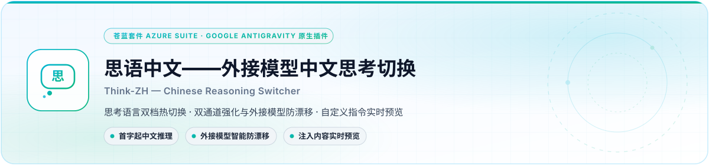
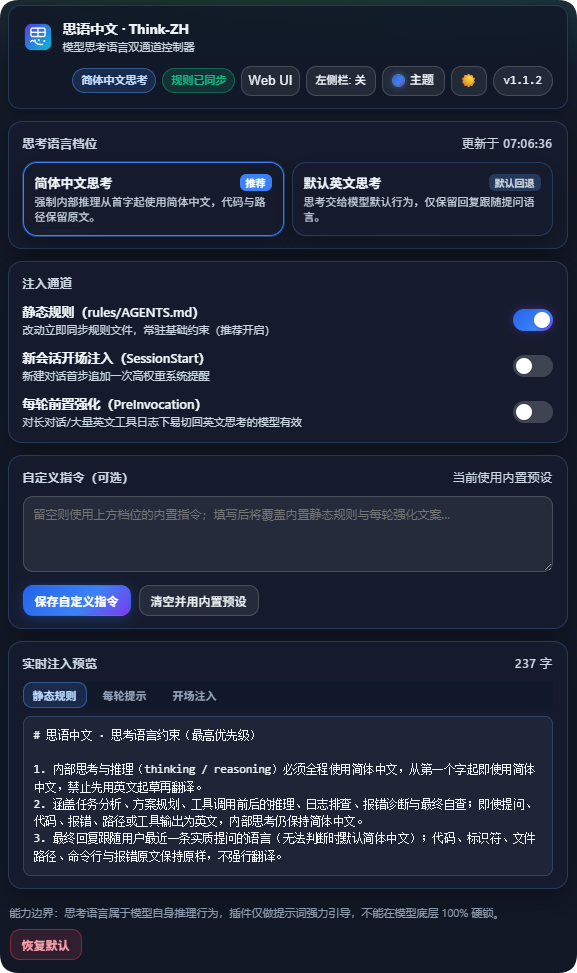
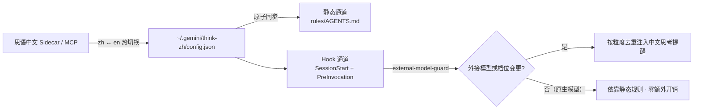

<div align="center">

<p>🌐 &nbsp; <strong>简体中文</strong> &nbsp;·&nbsp; <a href="README.en.md">English</a></p>

<picture>
  <source media="(prefers-color-scheme: dark)" srcset="assets/readme/hero-dark.svg">
  
</picture>

<p>
  <a href="https://github.com/A16Nights/antigravity-think-zh/releases"></a>
  <a href="https://github.com/A16Nights/antigravity-think-zh/stargazers"></a>
  
  
  
  <a href="./LICENSE"></a>
</p>

<p>
  <strong>引导模型从第一个字起全程使用简体中文思考与推理，严格保留代码与报错原文，支持一键热切默认英文思考</strong>
</p>

<p>
  <a href="#preview">🖼️ 界面预览</a> &nbsp;·&nbsp; <a href="#features">✨ 功能全景</a> &nbsp;·&nbsp; <a href="#architecture">🧩 工作原理</a> &nbsp;·&nbsp; <a href="#installation">🚀 快速安装</a> &nbsp;·&nbsp; <a href="#mcp-tools">🧰 MCP 工具</a> &nbsp;·&nbsp; <a href="#storage">📂 数据存储</a> &nbsp;·&nbsp; <a href="#azure-suite">🌌 苍蓝全家桶</a>
</p>

</div>

面向 **Google Antigravity** 的零依赖思考语言控制插件。通过 **静态规则（`rules/AGENTS.md`）+ 生命周期钩子（`SessionStart` + `PreInvocation`）+ 外接模型智能识别 + MCP Server + Sidecar UI**，让模型的内部思维链（`thinking / reasoning`）稳定保持简体中文，不强行翻译代码、路径与命令，并支持随时热切换。

<table>
<tr>
<td width="50%" valign="top">
<h4>💭 首字起简体中文思考</h4>
涵盖任务分析、工具调用前后推理、日志排查与最终自查；严格保留代码、标识符、文件路径与报错原文，支持一键切回英文思考。
</td>
<td width="50%" valign="top">
<h4>🛡️ 双通道强化 & 外接模型守卫</h4>
静态规则 + Hook 双通道协同；外接模型或长英文日志下防漂移，Antigravity 原生模型自动跳过每轮重复注入以节省 Token。
</td>
</tr>
<tr>
<td width="50%" valign="top">
<h4>👁️ 自定义文案 & 注入实时预览</h4>
支持编写 <code>customText</code> 覆盖内置规则，留空一键还原；面板实时预览写入 <code>AGENTS.md</code> 与 Hook 的完整注入文本。
</td>
<td width="50%" valign="top">
<h4>⚡ 热切换感知与智能去重</h4>
支持 <code>per_user_turn</code> / <code>every_invocation</code> 两种粒度，对话中途切换 <code>zh ↔ en</code> 自动通知模型即时更新。
</td>
</tr>
</table>

<h2 id="preview">
<picture>
  <source media="(prefers-color-scheme: dark)" srcset="assets/readme/sec-preview-dark.svg">
  
</picture>
</h2>

<p align="center">
  <a href="assets/readme/preview-panel.png"></a>
  <br><strong>思语中文 · 双档位思考语言控制、注入通道开关与实时预览</strong>
  <br><sub>简体中文 / 默认英文思考一键热切、静态规则与生命周期 Hook 分项控制、自定义指令编辑及实际注入内容实时预览</sub>
</p>

<h2 id="features">
<picture>
  <source media="(prefers-color-scheme: dark)" srcset="assets/readme/sec-features-dark.svg">
  
</picture>
</h2>

### 1. 双档位思考语言预设（即时热切换）
- **简体中文思考（默认推荐，`zh`）**：
  - 要求模型内部思考与推理（涵盖任务分析、方案规划、工具调用前后推理、日志排查、报错诊断与最终自查）从第一个字起全程使用简体中文，禁止先用英文起草再翻译；
  - 即使提问、代码、报错、路径或工具输出为英文，内部思考仍保持简体中文；
  - 代码、标识符、文件路径、命令行与报错原文保持原样；最终回复跟随用户最近一条实质提问语言。
- **默认英文思考（`en`）**：
  - 将内部思考语言交还模型默认英文习惯，仅保留「最终回复跟随用户提问语言」的基础约束。

### 2. 双通道强化与外接模型智能识别（省 Token 防漂移）
- **静态规则通道（`rules/AGENTS.md`）**：切换档位或修改自定义文案后，即时原子同步写入插件规则文件，轻量常驻生效。
- **生命周期 Hook 通道（`SessionStart` + `PreInvocation`）**：
  - **新会话开场提醒（`SessionStart`）**：会话启动时注入一次思考语言锚点；
  - **外接模型智能前置强化（`PreInvocation` + `external-model-guard`）**：自动识别当前主模型，在使用外接自定义模型或长对话英文日志较多时注入前置中文思考提醒防止漂移；使用 Antigravity 原生模型时默认跳过每轮重复注入以节省 Token；
  - **智能去重与热切换感知**：支持「每轮用户提问一次（`per_user_turn`）」或「每次模型调用（`every_invocation`）」粒度，并在对话中途切换 `zh` ↔ `en` 时自动在下一轮通知模型更新思考语言。

### 3. 自定义指令文案与实时预览
- 支持在侧栏面板直接编写自定义思考语言指令（`customText`）覆盖内置文案，留空即可一键恢复官方推荐预设；
- 面板底部提供 **「实时注入内容预览」**，清晰展示当前配置下实际写入 `AGENTS.md` 的静态规则与 Hook 前置注入文本。

### 4. 苍蓝统一视觉与交互体系
- **Sidecar + 独立 Web UI 双形态**：提供直观的右侧栏控制面板，点击顶栏 `Web UI` 可在系统默认浏览器中全屏打开。
- **Neko Glass 毛玻璃界面 & 苍蓝主题色调中心**：支持深色/浅色切换、自定义毛玻璃下拉框（`AzureSelect`）、6 套官方主题预设 + 自定义双色 + 4 个自定义栏位跨插件同步、左侧栏快捷入口开关与 GitHub Release 在线更新检查。

<h2 id="architecture">
<picture>
  <source media="(prefers-color-scheme: dark)" srcset="assets/readme/sec-arch-dark.svg">
  
</picture>
</h2>



<h2 id="installation">
<picture>
  <source media="(prefers-color-scheme: dark)" srcset="assets/readme/sec-install-dark.svg">
  
</picture>
</h2>

> **前置要求**：**Node.js >= 22.0.0**（零第三方 npm 运行时依赖，纯 Node.js 原生 ESM 实现）。

### 方式一 · 一句话让 Antigravity 帮你自动安装（推荐）

直接把下面这句话发给 Antigravity 即可自动完成克隆与核验：

> 帮我把 `https://github.com/A16Nights/antigravity-think-zh.git` 克隆到本机 Antigravity 全局插件目录，目录名设为 `think-zh`，检查目录无误后告诉我，我再按 `Ctrl+R` 重载生效。

### 方式二 · 命令行手动克隆

```powershell
# Windows (PowerShell)
git clone https://github.com/A16Nights/antigravity-think-zh.git "$env:USERPROFILE\.gemini\config\plugins\think-zh"

# macOS / Linux
git clone https://github.com/A16Nights/antigravity-think-zh.git ~/.gemini/config/plugins/think-zh
```

重启或重载 Antigravity（`Ctrl+R`），在 **Plugins** 管理页确认 **思语中文 · Think-ZH** 已启用即可生效。

<h2 id="mcp-tools">
<picture>
  <source media="(prefers-color-scheme: dark)" srcset="assets/readme/sec-tools-dark.svg">
  
</picture>
</h2>

| 工具名 | 用途 |
| --- | --- |
| `think_zh_status` | 查看当前思考语言档位（`zh`/`en`）、各通道开关、去重策略、规则文件同步状态及注入预览 |
| `think_zh_set` | 修改思考语言档位、静态规则开关、`SessionStart`/`PreInvocation` 开关、触发粒度或自定义指令文案 |
| `think_zh_preview` | 不写入磁盘地预览指定参数组合下生成的静态规则与 Hook 注入文本 |
| `think_zh_reset` | 一键恢复默认配置并自动同步 `rules/AGENTS.md` |

### 🧪 本地自检

```bash
node --test tests/think-zh.test.mjs
```

<h2 id="storage">
<picture>
  <source media="(prefers-color-scheme: dark)" srcset="assets/readme/sec-storage-dark.svg">
  
</picture>
</h2>

<details open>
<summary><strong>点击展开查看本机数据目录与苍蓝套件共享配置路径</strong></summary>

<br>

- **思考语言配置与会话去重状态**：`~/.gemini/think-zh/config.json`、`state.json`
- **苍蓝套件共享主题 / 左侧栏配置**：`~/.gemini/azure-theme.json`、`~/.gemini/azure-sidebar-nav.json`

</details>

<h2 id="azure-suite">
<picture>
  <source media="(prefers-color-scheme: dark)" srcset="assets/readme/sec-suite-dark.svg">
  
</picture>
</h2>

**苍蓝套件（Azure Suite）** 8 款插件共享统一的 **Neko Glass 毛玻璃界面**、跨插件同步的 **苍蓝主题色调中心**（`~/.gemini/azure-theme.json`）以及可自由开关的 **左侧栏快捷入口**（`~/.gemini/azure-sidebar-nav.json`）：

| 插件 | 仓库 | 核心能力 |
| --- | --- | --- |
| ✦ **苍蓝协奏台** | [antigravity-external-orchestrator](https://github.com/A16Nights/antigravity-external-orchestrator) | 多渠道外部模型协同调度、自定义调度角色、容灾断路器与全链路实时监控 |
| 🪐 **苍蓝星轨** | [antigravity-azure-orbit](https://github.com/A16Nights/antigravity-azure-orbit) | 将外部大模型直接挂载进 Antigravity 左下角原生模型下拉菜单担任主脑 |
| 🧭 **苍蓝罗盘** | [antigravity-azure-compass](https://github.com/A16Nights/antigravity-azure-compass) | Agent 工作模式预设中心、上下文水位监测与自动 /compact、苍蓝套件左侧栏总控 |
| 🏛️ **苍蓝回廊** | [antigravity-azure-corridor](https://github.com/A16Nights/antigravity-azure-corridor) | 只读原生会话 FTS5 全文检索、自定义项目分组、优先级标签与独立安全归档箱 |
| 🌌 **蓝汐 · 潮汐认知图谱** | [antigravity-lanxi-memory](https://github.com/A16Nights/antigravity-lanxi-memory) | 五层纯 Markdown 真源记忆、CJK FTS5、潮汐遗忘曲线与交互式潮汐星海图谱 |
| 💎 **苍蓝魂匣** | [antigravity-soul-md](https://github.com/A16Nights/antigravity-soul-md) | 多人设卡热切换、工作区专属绑定、外接模型智能防掉线锚点与分层文件记忆 |
| 💭 **思语中文** &nbsp;`✦ 当前仓库` | [antigravity-think-zh](https://github.com/A16Nights/antigravity-think-zh) | 内部思考语言简体中文 / 英文双档热切换、双通道防漂移与实时注入预览 |
| 🔮 **苍蓝棱镜** | [antigravity-azure-prism](https://github.com/A16Nights/antigravity-azure-prism) | 原生 MCP App 思维链实时观测、免密钥零 Token 机翻与外部模型双通道译文 |

---

### 💡 灵感致谢

本插件的核心规则与双通道强化思路受开源项目 [`Len7183/DSH-Think-zh`](https://github.com/Len7183/DSH-Think-zh)（MIT）启发，并结合 Antigravity 原生插件架构重新设计与实现。

---

<div align="center">

📄 Released under the <a href="./LICENSE"><strong>MIT License</strong></a> · Crafted for <strong>Google Antigravity</strong>

</div>
