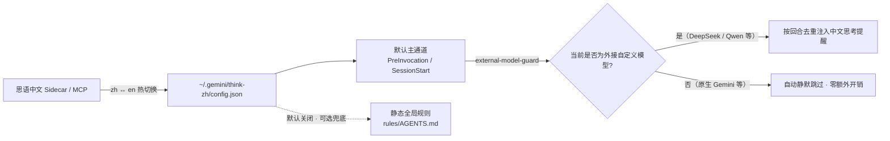

<div align="center">

<p>🌐 &nbsp; <strong>简体中文</strong> &nbsp;·&nbsp; <a href="README.en.md">English</a></p>

<picture>
  <source media="(prefers-color-scheme: dark)" srcset="assets/readme/hero-dark.svg">
  
</picture>

<p>
  <a href="https://github.com/A16Nights/antigravity-think-zh/releases"></a>
  <a href="https://github.com/A16Nights/antigravity-think-zh/stargazers"></a>
  
  
  
  <a href="./LICENSE"></a>
</p>

<p>
  <strong>思语中文——外接模型中文思考切换 · 专为外部推理模型准备：引导外接模型从第一个字起全程使用简体中文思考与推理，原生 Antigravity / Gemini 模型自动跳过</strong>
</p>

<p>
  <a href="#preview">🖼️ 界面预览</a> &nbsp;·&nbsp; <a href="#features">✨ 功能全景</a> &nbsp;·&nbsp; <a href="#architecture">🧩 工作原理</a> &nbsp;·&nbsp; <a href="#installation">🚀 快速安装</a> &nbsp;·&nbsp; <a href="#mcp-tools">🧰 MCP 工具</a> &nbsp;·&nbsp; <a href="#storage">📂 数据存储</a> &nbsp;·&nbsp; <a href="#azure-suite">🌌 苍蓝全家桶</a>
</p>

</div>

> [!IMPORTANT]
> **适用范围与原生 Gemini 限制说明**
> - **专为外部模型准备**：本插件面向通过 **[苍蓝星轨 (Azure Orbit)](https://github.com/A16Nights/antigravity-azure-orbit)** 等方式挂载到 Antigravity 的**外部推理模型**（如 DeepSeek、Qwen、GLM、MiniMax 等直接透传原生 `reasoning_content` 的模型）。开启后**仅在使用外部模型时自动生效**，使用 Antigravity 原生模型时自动静默跳过，零额外 Token 消耗。
> - **为何无法对原生 Gemini 生效**：Google Cloud Code 服务端不会将 Gemini 的原始内部思考下发给客户端，而是由云端 **Thought Summarizer** 将内部思考压缩改写成客观的英文第三人称摘要返回（并附带本地无法解密的加密 `thoughtSignature`）。因此任何客户端提示词或 Hook 都无法关闭或更改云端摘要器的输出语言。
> - **原生 Gemini 怎么看中文思考**：若希望在原生 Gemini 会话中以中文阅读思考摘要，请使用苍蓝套件中的 **[苍蓝棱镜 (Azure Prism)](https://github.com/A16Nights/antigravity-azure-prism)** 进行按需翻译。

面向 **Google Antigravity** 外部自定义推理模型的零依赖思考语言控制插件。通过 **外接模型智能守卫（`external-model-guard`）+ 生命周期 Hook（默认开启 `PreInvocation` 回合去重强化 + 可选 `SessionStart`）+ 可选静态兜底规则 + MCP Server + Sidecar UI**，让外接推理模型的内部思维链（`thinking / reasoning`）稳定保持简体中文，不强行翻译代码、路径与命令，并支持随时热切换。

<table>
<tr>
<td width="50%" valign="top">
<h4>💭 外部模型首字起中文思考</h4>
专为透传原生 <code>reasoning_content</code> 的外接推理模型设计；涵盖任务分析、工具调用前后推理与报错诊断，严格保留代码与路径原文。
</td>
<td width="50%" valign="top">
<h4>🛡️ 仅外部模型生效 · 原生自动跳过</h4>
内置 <code>external-model-guard</code> 守卫，自动识别 <code>custom_models.json</code> 与外接模型标识；原生 Gemini / Antigravity 模型默认静默跳过，零无效注入。
</td>
</tr>
<tr>
<td width="50%" valign="top">
<h4>👁️ 自定义文案 & 注入实时预览</h4>
支持编写 <code>customText</code> 覆盖内置规则，留空一键还原；面板实时预览每轮 Hook、开场注入与静态兜底的完整文本。
</td>
<td width="50%" valign="top">
<h4>⚡ 热切换感知与回合级去重</h4>
支持 <code>per_user_turn</code> / <code>every_invocation</code> 两种粒度，同轮多步工具调用自动去重，中途切换 <code>zh ↔ en</code> 自动通知模型即时更新。
</td>
</tr>
</table>

<h2 id="preview">
<picture>
  <source media="(prefers-color-scheme: dark)" srcset="assets/readme/sec-preview-dark.svg">
  
</picture>
</h2>

<p align="center">
  <a href="assets/readme/preview-panel.png"></a>
  <br><strong>思语中文 · 双档位思考语言控制、注入通道开关与实时预览</strong>
  <br><sub>简体中文 / 默认英文思考一键热切、静态规则与生命周期 Hook 分项控制、自定义指令编辑及实际注入内容实时预览</sub>
</p>

<h2 id="features">
<picture>
  <source media="(prefers-color-scheme: dark)" srcset="assets/readme/sec-features-dark.svg">
  
</picture>
</h2>

### 1. 双档位思考语言预设（即时热切换）
- **简体中文思考（默认推荐，`zh`）**：
  - 要求模型内部思考与推理（涵盖任务分析、方案规划、工具调用前后推理、日志排查、报错诊断与最终自查）从第一个字起全程使用简体中文，禁止先用英文起草再翻译；
  - 即使提问、代码、报错、路径或工具输出为英文，内部思考仍保持简体中文；
  - 代码、标识符、文件路径、命令行与报错原文保持原样；最终回复跟随用户最近一条实质提问语言。
- **默认英文思考（`en`）**：
  - 将内部思考语言交还模型默认英文习惯，仅保留「最终回复跟随用户提问语言」的基础约束。

### 2. 仅外部模型生效的智能守卫（原生模型零干扰）
- **每轮前置强化（`PreInvocation` + `external-model-guard`，默认开启）**：
  - 自动读取 `~/.gemini/antigravity/custom_models.json` 与外接模型路径特征，**仅在使用外部自定义模型时触发注入**；
  - 使用 Antigravity 原生模型（含原生 Gemini）时直接静默跳过返回 `{}`，零额外 Token 消耗；
  - **智能去重与热切换感知**：默认 `per_user_turn`（每轮用户提问注入一次，同轮工具回调自动去重），可选 `every_invocation`，并在对话中途切换 `zh` ↔ `en` 时自动通知模型更新思考语言。
- **新会话开场提醒（`SessionStart` + `external-model-guard`，可选）**：同样仅在识别到外部模型时于会话首步注入一次思考语言锚点。
- **静态全局规则兜底（`rules/AGENTS.md`，默认关闭）**：由于宿主会无差别将静态规则加载给包括原生 Gemini 在内的所有模型，默认保持关闭；仅在确需全模型静态兼容兜底时手动开启。

### 3. 自定义指令文案与实时预览
- 支持在侧栏面板直接编写自定义思考语言指令（`customText`）覆盖内置文案，留空即可一键恢复官方推荐预设；
- 面板底部提供 **「实时注入内容预览」**，清晰展示当前配置下实际写入 `AGENTS.md` 的静态规则与 Hook 前置注入文本。

### 4. 苍蓝统一视觉与交互体系
- **Sidecar + 独立 Web UI 双形态**：提供直观的右侧栏控制面板，点击顶栏 `Web UI` 可在系统默认浏览器中全屏打开。
- **Neko Glass 毛玻璃界面 & 苍蓝主题色调中心**：支持深色/浅色切换、自定义毛玻璃下拉框（`AzureSelect`）、6 套官方主题预设 + 自定义双色 + 4 个自定义栏位跨插件同步、左侧栏快捷入口开关与 GitHub Release 在线更新检查。


### 首次使用交互式新手引导（`? 指南`）
- **3 步上手教程 + 真实控件定位高亮**：首次打开面板自动弹出分步功能指南，点击「🎯 定位」按钮可在当前界面脉冲高亮对应控件并附带浮动返回条。
- **本机持久化不复弹**：已读状态保存至 `~/.gemini/azure-onboarding.json`（Sidecar 重启换端口不复弹），日后随时可点击顶栏 **`? 指南`** 重看。

<h2 id="architecture">
<picture>
  <source media="(prefers-color-scheme: dark)" srcset="assets/readme/sec-arch-dark.svg">
  
</picture>
</h2>



<h2 id="installation">
<picture>
  <source media="(prefers-color-scheme: dark)" srcset="assets/readme/sec-install-dark.svg">
  
</picture>
</h2>

> **前置要求**：**Node.js >= 22.0.0**（零第三方 npm 运行时依赖，纯 Node.js 原生 ESM 实现）。

### 方式一 · 一句话让 Antigravity 帮你自动安装（推荐）

直接把下面这句话发给 Antigravity 即可自动完成克隆与核验：

> 帮我把 `https://github.com/A16Nights/antigravity-think-zh.git` 克隆到本机 Antigravity 全局插件目录，目录名设为 `think-zh`，检查目录无误后告诉我，我再按 `Ctrl+R` 重载生效。

### 方式二 · 命令行手动克隆

```powershell
# Windows (PowerShell)
git clone https://github.com/A16Nights/antigravity-think-zh.git "$env:USERPROFILE\.gemini\config\plugins\think-zh"

# macOS / Linux
git clone https://github.com/A16Nights/antigravity-think-zh.git ~/.gemini/config/plugins/think-zh
```

重启或重载 Antigravity（`Ctrl+R`），在 **Plugins** 管理页确认 **思语中文 · Think-ZH** 已启用即可生效。

<h2 id="mcp-tools">
<picture>
  <source media="(prefers-color-scheme: dark)" srcset="assets/readme/sec-tools-dark.svg">
  
</picture>
</h2>

| 工具名 | 用途 |
| --- | --- |
| `think_zh_status` | 查看当前思考语言档位（`zh`/`en`）、各通道开关、去重策略、规则文件同步状态及注入预览 |
| `think_zh_set` | 修改思考语言档位、静态规则开关、`SessionStart`/`PreInvocation` 开关、触发粒度或自定义指令文案 |
| `think_zh_preview` | 不写入磁盘地预览指定参数组合下生成的静态规则与 Hook 注入文本 |
| `think_zh_reset` | 一键恢复默认配置并自动同步 `rules/AGENTS.md` |

### 🧪 本地自检

```bash
node --test tests/think-zh.test.mjs
```

<h2 id="storage">
<picture>
  <source media="(prefers-color-scheme: dark)" srcset="assets/readme/sec-storage-dark.svg">
  
</picture>
</h2>

<details open>
<summary><strong>点击展开查看本机数据目录与苍蓝套件共享配置路径</strong></summary>

<br>

- **思考语言配置与会话去重状态**：`~/.gemini/think-zh/config.json`、`state.json`
- **苍蓝套件共享主题 / 左侧栏配置**：`~/.gemini/azure-theme.json`、`~/.gemini/azure-sidebar-nav.json`

</details>

<h2 id="azure-suite">
<picture>
  <source media="(prefers-color-scheme: dark)" srcset="assets/readme/sec-suite-dark.svg">
  
</picture>
</h2>

**苍蓝套件（Azure Suite）** 11 款插件共享统一的 **Neko Glass 毛玻璃界面**、跨插件同步的 **苍蓝主题色调中心**（`~/.gemini/azure-theme.json`）以及可自由开关的 **左侧栏快捷入口**（`~/.gemini/azure-sidebar-nav.json`）：

| 插件 | 仓库 | 核心能力 |
| --- | --- | --- |
| ✦ **苍蓝协奏台——外部模型调度与省流** | [antigravity-external-orchestrator](https://github.com/A16Nights/antigravity-external-orchestrator) | 多渠道外部模型协同调度、自定义调度角色、容灾断路器、全链路监控与首次新手引导 |
| 🪐 **苍蓝星轨——原生菜单外接模型挂载** | [antigravity-azure-orbit](https://github.com/A16Nights/antigravity-azure-orbit) | 将外部大模型直接挂载进 Antigravity 左下角原生模型下拉菜单担任主脑 |
| 🧭 **苍蓝罗盘——Agent 预设与上下文监控** | [antigravity-azure-compass](https://github.com/A16Nights/antigravity-azure-compass) | Agent 工作模式预设中心、上下文水位监测与自动 /compact、苍蓝套件左侧栏总控 |
| 🏛️ **苍蓝回廊——会话与工作区管理** | [antigravity-azure-corridor](https://github.com/A16Nights/antigravity-azure-corridor) | 纯官方原生会话与工作区同步、FTS5 全文检索、自选快捷标签栏、跨工作区转移续聊与新手引导 |
| 🌌 **蓝汐——认知图谱长期记忆** | [antigravity-lanxi-memory](https://github.com/A16Nights/antigravity-lanxi-memory) | 五层纯 Markdown 真源记忆、CJK FTS5、潮汐遗忘曲线与交互式潮汐星海图谱 |
| 💎 **苍蓝魂匣——人设卡与分层记忆** | [antigravity-soul-md](https://github.com/A16Nights/antigravity-soul-md) | 多人设卡热切换、工作区专属绑定、外接模型智能防掉线锚点与分层文件记忆 |
| 💭 **思语中文——外接模型中文思考切换** &nbsp;`✦ 当前仓库` | [antigravity-think-zh](https://github.com/A16Nights/antigravity-think-zh) | 外接推理模型内部思考简体中文 / 英文热切换、双通道防漂移与实时注入预览 |
| 🔮 **苍蓝棱镜——思维链观测与实时翻译** | [antigravity-azure-prism](https://github.com/A16Nights/antigravity-azure-prism) | 原生 MCP App 思维链实时观测、免密钥零 Token 机翻与外部模型双通道译文 |
| 🪄 **苍蓝魔杖——Windows 桌面与网页操控** | [antigravity-azure-wand](https://github.com/A16Nights/antigravity-azure-wand) | Windows 桌面与网页低打扰操控台、独立输入 15 状态 AI 光标、套装画廊混搭与外部光标导入 |
| 🍃 **苍蓝流笺——拖拽发图与原生文件标签** | [antigravity-azure-drop](https://github.com/A16Nights/antigravity-azure-drop) | 零 `app.asar` 侵入、拖拽与粘贴插入原生文件标签、无损 PNG 截图落盘、图片缩略图灯箱与面包屑右键菜单 |
| 🔭 **苍蓝星瞳——多账号 Gemini 网页副脑** &nbsp;`Beta` | [antigravity-azure-lens](https://github.com/A16Nights/antigravity-azure-lens) | 1:1 原生双态 Gemini 侧栏、双标签物理隔离、多账号独立 Profile 自动检测、免跳转内部弹窗与 MCP 静默调研审阅 |

---

### 💡 灵感致谢

本插件的核心规则与双通道强化思路受开源项目 [`Len7183/DSH-Think-zh`](https://github.com/Len7183/DSH-Think-zh)（MIT）启发，并结合 Antigravity 原生插件架构重新设计与实现。

---

<div align="center">

📄 Released under the <a href="./LICENSE"><strong>MIT License</strong></a> · Crafted for <strong>Google Antigravity</strong>

</div>
